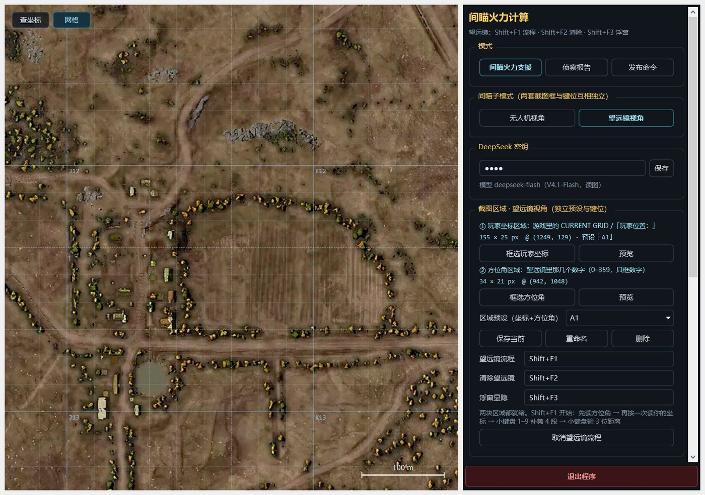
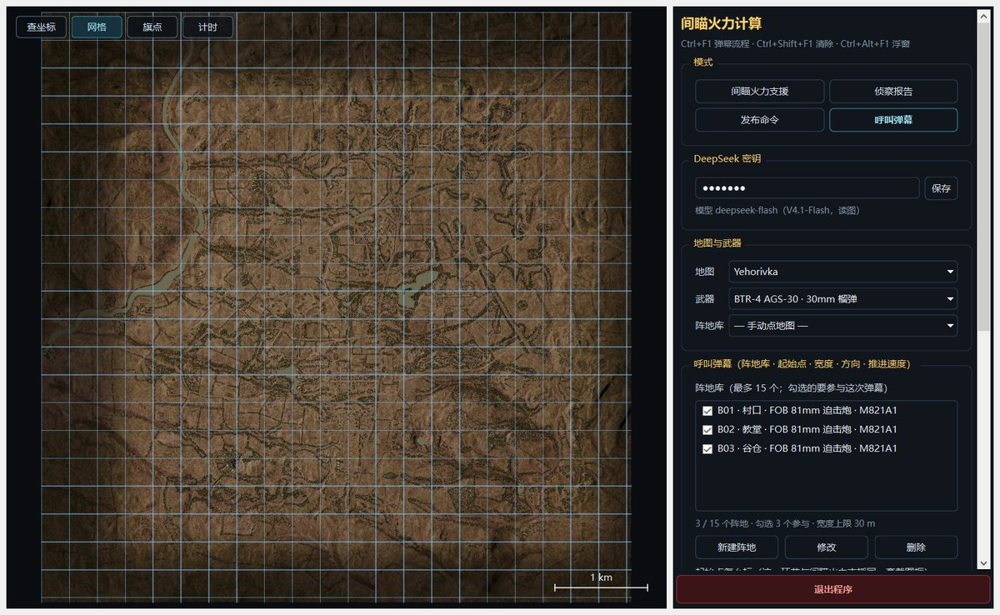
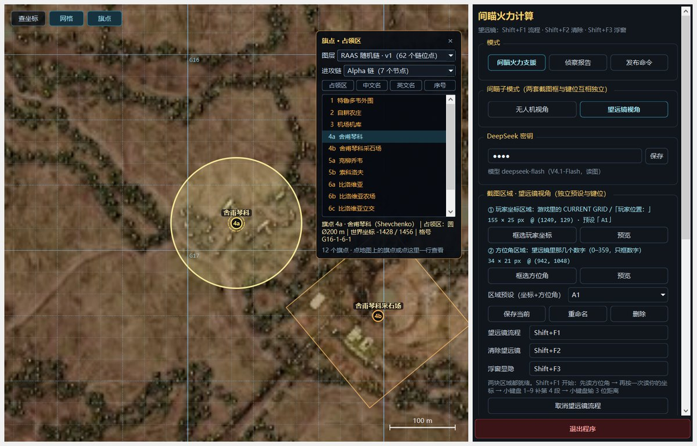
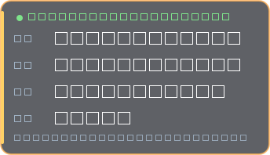
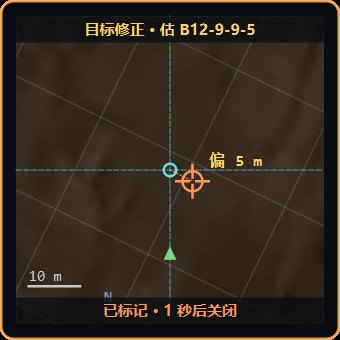

# Squad 间瞄火力助手（ArtyCalc）

一个给《战术小队》（Squad）玩家用的 Windows 桌面工具：**高清战术地图 + 间瞄火力弹道解算 + 游戏内 HUD 识图叠层**。

在地图上点出炮位，切回游戏按一下热键，程序截取屏幕上的 `CURRENT GRID` 区域，用 AI 认坐标，直接在游戏画面上
叠一层半透明浮窗，显示**密位 / 射角**与**方位角**，并把结果复制进剪贴板。



> 不注入游戏进程、不读内存、不改游戏文件——只做屏幕截图识别与地图计算，浮窗是普通的置顶窗口。

---

## 功能一览

| 模式 | 说明 |
| --- | --- |
| **间瞄火力支援** | 无人机视角 / 望远镜视角两个子模式，各有一套截图框、区域预设与热键；支持 42 组武器、低抛 / 高抛弹道切换 |
| **侦察报告** | 标记敌方目标入库，连打队友坐标，生成「队友视角」的播报句 |
| **发布命令** | 选阵营与部队，用小键盘走完「队长 → 4 级坐标 → 任务 → 态度」，整句命令复制进剪贴板 |
| **呼叫弹幕** | 阵地库批量算诸元：起始线宽度、推进方向与轮次、每门每轮的目标点 |

地图侧还有：**三级 3×3 子格**（`F11-2-5-6` 粒度约 3.7 m）、查坐标、旗点 / 占领区（RAAS / AAS 图层）、
倒计时、**弹道遮挡判定**（地形 / 建筑 / 树木三路求交）、望远镜 120 m 与无人机 60 m **朝向朝上的小地图**。

<table>
<tr>
<td></td>
<td></td>
</tr>
</table>

<p align="center">
  
  
</p>

---

## 快速开始

需要 **Windows + Python 3.10 以上**（开发环境 Python 3.14.5）。

```bat
git clone https://github.com/copperbookworm/ArtyCalc.git
cd ArtyCalc
pip install -r requirements.txt
```

双击 `启动.bat`（无控制台窗口），或：

```bat
python main.py
```

### 第一次使用的三步

1. **填 DeepSeek 密钥**：面板上的「DeepSeek 密钥」输入框 → 「保存」。密钥保存在同目录的 `config.json`（明文，
   只在本机；不想留就删掉该字段）。识图模型固定 `deepseek-flash`（支持读图）。
2. **框截图区域**：先选「间瞄子模式」，再点「框选坐标区域」——屏幕变暗后**只框住 HUD 里 `CURRENT GRID` 那两三行字**，
   框里不要放血条、图标、聊天框。方位角区域同理，**只框那几个数字**。每块都有「预览截图」可以先确认。
3. **选地图 + 武器**，（可选）改热键：点一下右边的输入框，直接按下你想用的键即可。

进游戏前建议先用「**演练（假 HUD，端到端自测）**」跑一遍：它会在你框好的区域里摆一块假坐标，走真截图、真接口，
确认密钥、区域、识别链路都通。

> 游戏请设成**无边框窗口（Borderless）**：独占全屏下浮窗会被盖住。

---

## 目录结构

```
ArtyCalc/
├─ main.py          主界面：地图点选 / 4 级网格 / 查坐标 / 旗点 / 计时、间瞄双子模式、侦察、发布命令、呼叫弹幕、热键、演练
├─ overlay.py       半透明浮窗
├─ vision.py        截图 + DeepSeek 识图 + 坐标归一化
├─ docr.py          方位角本地数字识别（双尺度模板匹配 + 自学习）
├─ posocr.py        网格坐标本地识别（四尺度 + 坐标窗口匹配 + 位置约束）
├─ core.py          弹道解算（抛体双解、飞行时间、散布、射界、减速弹丸 RK2 积分）
├─ los.py           弹道遮挡（地形高程场 + 建筑盒 + 树木包围盒）
├─ mapsdata.py      底图 / 高程读取与坐标换算
├─ barrage.py       呼叫弹幕的几何（阵地库、起始线、推进方向）
├─ flagzones.py     旗点 / 占领区图层
├─ targetsdb.py     侦察目标库（sqlite）
├─ data/            地图元数据、武器表、敌情表、阵营编制表、本地 OCR 模板库、遮挡数据包
├─ docs/            完整中文手册（manual-zh.md）与截图
├─ tools/           数据构建脚本（重建模板库 / 敌情 / 阵营 / 地图库 / 遮挡包）
├─ config.json      运行时自动生成：密钥、截图框、热键、浮窗位置
└─ 启动.bat         双击即用
```

## 数据说明

- `data/maps/` 是 25 张官方地图的低清底图与 1024×1024 高程图（约 48 MB），随仓库分发，clone 下来就能跑。
- **高清地图库**（`mapsdb/`，8192² 底图 + 缩略图，约 444 MB）**不随仓库分发**：用 `tools/build_mapdb.py`
  从本地地图资源生成，放到程序目录下的 `mapsdb/`（或设置环境变量 `ARTY_MAPDB`）。找不到时自动退回 `data/maps/` 的底图。
- `data/los/*.npz` 是遮挡包（建筑与树木包围盒），由 `tools/build_los_pack.py` 从本地资源重建。

## 打包成单文件 exe

```bat
python -m PyInstaller --noconfirm --clean --onefile --windowed ^
  --name "Squad间瞄火力助手" --icon app.ico ^
  --add-data "data;data" --add-data "mapsdb;mapsdb" main.py
```

产物约 500 MB（高清地图在里面），双击后需要 6~8 秒解包才见窗口，属正常现象。

## 已知限制

- **AI 会读错字母**（`I12-6-2` → `L12-6-2`）；重要目标建议自己扫一眼格号。
- 只支持官方 25 张图；模组地图没有高程数据。
- 高程是 1024 网格插值（1 格约 6 m），断崖、桥下有偏差——**结果只作估算**。
- 热键被别的程序占用时会注册失败（面板提示行变红），换一个键即可。
- `main.py` 开头保留了 `pycrefine` 的还原提示：有 6 处（`MapView._reload_flags`、`OcrWorker.run`、
  `MainWindow._build_panel`、`MainWindow._clear_rows`）未能从打包产物可靠还原，改动前请先读注释并自测。

## 免责声明

本项目仅用于**单机 / 私人服务器环境下的地图与弹道计算**，不读取游戏内存、不注入进程、不修改游戏文件。
在官方服务器使用任何第三方辅助工具都可能违反游戏服务条款，**风险与后果由使用者自行承担**。
仓库中 `data/maps/` 的地图底图与高程由本地游戏资源生成，版权归游戏开发商及其权利人所有，仅作技术演示用途；
如权利人提出要求，将移除相关内容。

## 参考资料

- 弹道解算的公式骨架参考 [SquadCalc](https://github.com/sh4rkman/SquadCalc)（sh4rkman，MIT-NC）；
  1.14.0 起武器参数与射界已按游戏本体 `pak` 逐项复核。

## 许可证

[MIT](LICENSE)

完整中文手册（每个模式的操作细节、算法与数据来源）见 **[docs/manual-zh.md](docs/manual-zh.md)**。
